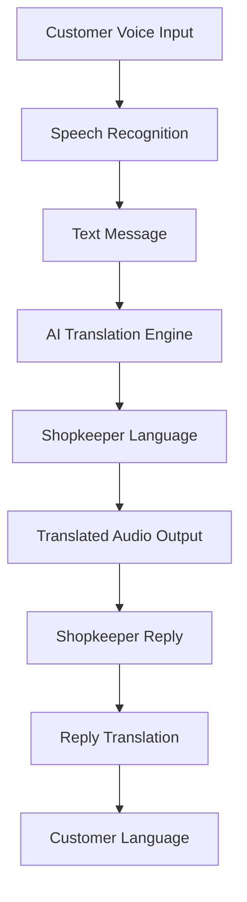

# 🎙️ Voice Khata AI

### Breaking Language Barriers Between Customers and Shopkeepers

Voice Khata AI is an AI-powered multilingual communication platform designed to help customers and shopkeepers communicate easily without language barriers.

The application enables customers to communicate in their preferred language while helping shopkeepers understand customer requests through translation and voice-based interaction.

## 🚀 Project Overview

In local grocery shops, customers and shopkeepers may speak different languages. This can lead to misunderstandings, communication difficulties, and incorrect orders.

Voice Khata AI addresses this problem using AI-powered language translation and voice technologies to make communication easier, faster, and more accessible.

## 🎯 Problem Statement

Language differences between customers and shopkeepers create communication barriers in everyday shopping. Customers may struggle to explain their requirements, while shopkeepers may not understand the customer's preferred language.

There is a need for a simple multilingual communication platform that enables both parties to interact naturally in their own languages.

## ✨ Key Features

- **Multilingual Communication:** Supports communication in 10 Indian languages.
- **Voice Input:** Customers can speak instead of typing their requirements.
- **Speech-to-Text:** Converts spoken messages into text.
- **AI-Powered Translation:** Translates messages into the selected target language.
- **Text-to-Speech:** Converts translated messages into audio.
- **Two-Way Communication:** Designed to translate customer requests to the shopkeeper and shopkeeper replies back to the customer.
- **Grocery Vocabulary Support:** Focuses on common grocery-related words and expressions.
- **User-Friendly Interface:** Provides a simple interface for customer and shopkeeper communication.

## 🌐 Supported Languages

Voice Khata AI supports the following 10 languages:

1. English
2. Hindi
3. Kannada
4. Telugu
5. Tamil
6. Malayalam
7. Marathi
8. Bengali
9. Gujarati
10. Punjabi

## 🔄 How It Works

1. The customer speaks or enters a message.
2. The application converts voice input into text.
3. The message is translated into the shopkeeper's selected language.
4. The translated message can be played as audio.
5. The shopkeeper can respond in their preferred language.
6. The reply is translated back into the customer's language.

## 🏗️ System Architecture



## 🛠️ Technology Stack

### Frontend
- React.js
- Vite
- JavaScript
- HTML
- CSS

### Backend
- Python
- FastAPI
- REST APIs

### AI and Language Technologies
- Bodhan AI – Language translation
- Gnani Vachana – Voice-related integration
- Google Gemini API – AI integration

### Tools and Deployment
- Git and GitHub
- Visual Studio Code
- Vercel – Frontend deployment
- Render – Backend deployment

## 📁 Project Structure

```text
voice-khata-ai/
│
├── backend/
│   ├── main.py
│   ├── language_bridge.py
│   ├── speech_service.py
│   ├── voice_service.py
│   └── requirements.txt
│
├── frontend/
│   ├── src/
│   ├── public/
│   ├── package.json
│   └── vite.config.js
│
├── .env
├── .gitignore
└── README.md
```

## ⚙️ Installation and Setup

### 1. Clone the Repository

```bash
git clone https://github.com/trenvitha8-spec/voice-khata-ai.git
cd voice-khata-ai
```

### 2. Set Up the Backend

Create and activate a Python virtual environment:

```bash
python -m venv .venv
```

On Windows PowerShell:

```powershell
.\.venv\Scripts\Activate.ps1
```

Install the required packages:

```bash
pip install -r backend/requirements.txt
```

Create a `.env` file in the project root and configure the required API keys:

```env
GNANI_API_KEY=your_gnani_api_key
GEMINI_API_KEY=your_gemini_api_key
BODHAN_API_KEY=your_bodhan_api_key
```

Start the backend:

```bash
uvicorn backend.main:app --reload
```

Backend runs locally at:

`http://127.0.0.1:8000`

API documentation:

`http://127.0.0.1:8000/docs`

### 3. Set Up the Frontend

Open another terminal:

```bash
cd frontend
npm install
```

Create a `.env` file inside the `frontend` directory:

```env
VITE_API_URL=http://127.0.0.1:8000
```

Start the frontend:

```bash
npm run dev
```

Open the local URL displayed in the terminal.

## 🌍 Live Application

- **Frontend:** https://voice-khata-ai.vercel.app/
- **Backend:** https://voice-khata-ai.onrender.com
- **API Documentation:** https://voice-khata-ai.onrender.com/docs

## 🔐 Security

- API keys are stored in environment variables.
- Secret credentials should never be committed to GitHub.
- The `.env` file is excluded from version control.

## 🔮 Future Enhancements

- Improve automatic language identification.
- Complete and validate two-way voice conversation across all supported languages.
- Expand grocery-specific vocabulary and translation accuracy.
- Improve speech recognition in noisy shop environments.
- Add order summaries and voice-assisted shopping support.
- Enhance accessibility and user experience.

## 💡 Project Goal

Our goal is to make everyday shopping easier by using AI and voice technology to connect customers and shopkeepers, regardless of the language they speak.

**Voice Khata AI – Speak Your Language. Shop Without Barriers.**